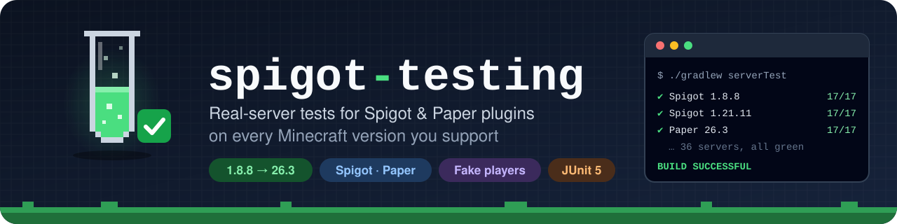
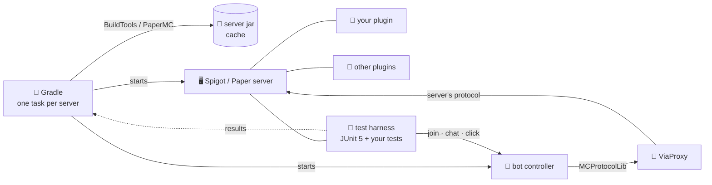

<div align="center">



Your plugin, on real servers, against real players, on every Minecraft version you support.

[](https://github.com/lars-lewerenz/spigot-testing/actions/workflows/ci.yml)


[](LICENSE)

[Features](#-features) ·
[Quick start](#-quick-start) ·
[Writing tests](#%EF%B8%8F-writing-tests) ·
[Fake players](#-fake-players) ·
[Server files](#%EF%B8%8F-server-files--configs) ·
[Other plugins](#-other-plugins) ·
[Configuration](#%EF%B8%8F-configuration) ·
[CI](#-ci-on-github-actions) ·
[How it works](#%EF%B8%8F-how-it-works)

</div>

---

Mocking the Bukkit API only tells you how your plugin behaves against your *idea* of the server.
**spigot-testing** starts the real thing — Spigot built with BuildTools, Paper straight from
PaperMC — loads your plugin, runs your JUnit 5 tests inside it, lets bot players join over the
real network protocol, and does that for every version you list, in parallel.

```text
$ ./gradlew serverTest
[Spigot 1.8.8]   PASSED GreeterMenuTest > clickingThePaperGreetsAndClosesTheMenu()
[Paper 26.3]   PASSED GreeterPlayerTest > chatReachesOtherPlayers()
…
[Spigot 1.8.8] CraftBukkit git-Spigot-3c60ece-741a1bd (MC: 1.8.8): 36 tests, 34 passed, 0 failed, 2 skipped, 0 aborted (51 s, with a restart)
[Spigot 1.12.2] CraftBukkit git-Spigot-79a30d7-f4830a1 (MC: 1.12.2): 36 tests, 34 passed, 0 failed, 2 skipped, 0 aborted (52 s, with a restart)
[Paper 1.8.8] CraftBukkit git-PaperSpigot-445 (MC: 1.8.8): 36 tests, 34 passed, 0 failed, 2 skipped, 0 aborted (58 s, with a restart)
[Spigot 26.3] Spigot 4664-Spigot-bed90fc-e89124d (MC: 26.3): 36 tests, 34 passed, 0 failed, 2 skipped, 0 aborted (59 s, with a restart)
[Paper 26.3] Paper 26.3-253-63e41db (MC: 26.3): 36 tests, 34 passed, 0 failed, 2 skipped, 0 aborted (59 s, with a restart)
[Spigot 1.20.4] CraftBukkit 4090-Spigot-b754dcc-38b1f49 (MC: 1.20.4): 36 tests, 34 passed, 0 failed, 2 skipped, 0 aborted (61 s, with a restart)
[Spigot 1.21.11] CraftBukkit 4598-Spigot-56165ca-d74c5d8 (MC: 1.21.11 Unobfuscated): 36 tests, 34 passed, 0 failed, 2 skipped, 0 aborted (63 s, with a restart)
[Paper 1.21.11] Paper 1.21.11-132-c5eb079 (MC: 1.21.11): 36 tests, 34 passed, 0 failed, 2 skipped, 0 aborted (65 s, with a restart)

BUILD SUCCESSFUL in 1m 10s
```

## ✨ Features

|   |   |
|---|---|
| 🖥️ **Real servers** | Spigot built with BuildTools, Paper downloaded from PaperMC. One Gradle task per server, all running in parallel. |
| 🕰️ **1.8.8 → 26.x** | Every version runs on the Java it needs (8, 17, 21, 25) — picked from the server's metadata and downloaded by Gradle toolchains. |
| 🤖 **Fake players** | Bots join over the real network protocol, chat, run commands, walk, build, fight and use items — on every version, through ViaProxy. |
| 🗃️ **Inventory GUIs** | Bots see the menus your plugin opens and click them; you get genuine `InventoryClickEvent`s. |
| 🗂️ **Server files** | Whole plugin config folders, custom files and `server.properties` settings, laid onto every server — or only Paper, or only one version. |
| 🔌 **Other plugins** | Vault, PlaceholderAPI, LuckPerms… installed next to yours from Maven, local files or download URLs. |
| 🎯 **Just JUnit 5** | Familiar assertions and annotations; JUnit XML reports for your CI. |
| 🧩 **Unit tests too** | Plain `src/test` tests on the build JVM, with the Spigot API on the classpath. |
| ⚡ **Fast after the first run** | Servers, JDKs and downloads are cached per machine: 8 servers × 36 tests in about a minute. |

### Supported servers

Every major Minecraft version from 1.8.8 to 26.3, on **Spigot** and **Paper** — 36 servers, all
running the example plugin's full suite (36 tests):

| | 1.8.8 | 1.9.4 | 1.10.2 | 1.11.2 | 1.12.2 | 1.13.2 | 1.14.4 | 1.15.2 | 1.16.5 | 1.17.1 | 1.18.2 | 1.19.4 | 1.20.4 | 1.20.6 | 1.21.4 | 1.21.11 | 26.1.2 | 26.3 |
|---|:-:|:-:|:-:|:-:|:-:|:-:|:-:|:-:|:-:|:-:|:-:|:-:|:-:|:-:|:-:|:-:|:-:|:-:|
| **Spigot** | ✅ | ✅ | ✅ | ✅ | ✅ | ✅ | ✅ | ✅ | ✅ | ✅ | ✅ | ✅ | ✅ | ✅ | ✅ | ✅ | ✅ | ✅ |
| **Paper**  | ✅ | ✅ | ✅ | ✅ | ✅ | ✅ | ✅ | ✅ | ✅ | ✅ | ✅ | ✅ | ✅ | ✅ | ✅ | ✅ | ✅ | ✅ |
| **Java**   | 8 | 8 | 8 | 8 | 8 | 8 | 8 | 8 | 8 | 17 | 17 | 17 | 17 | 21 | 21 | 21 | 25 | 25 |

- **Spigot** is built with [BuildTools](https://www.spigotmc.org/wiki/buildtools/) (its jars can't
  be redistributed), **Paper** is downloaded from [PaperMC](https://papermc.io/downloads) and
  checked against its SHA-256. Both are cached per machine.
- **Java** is picked per server: the lowest LTS release the server supports, read from the
  server's own metadata.
- **Paper plugins** (`paper-plugin.yml`, Brigadier commands, Adventure) work too: the test harness
  then becomes a Paper plugin itself, so tests can use your plugin's classes. See
  [`example-paper-plugin`](example-paper-plugin).
- CI tests 8 of them on every push; the [compatibility workflow](.github/workflows/compatibility.yml)
  runs all 36 on demand. Versions in between work the same way — just list them.

## 🚀 Quick start

**1.** Apply the plugin (from the [Gradle Plugin Portal](https://plugins.gradle.org/plugin/io.github.lars-lewerenz.spigot-testing) — no credentials needed) and pick your servers:

```kotlin
// build.gradle.kts
plugins {
    java
    id("io.github.lars-lewerenz.spigot-testing") version "0.7.0"
}

repositories {
    mavenCentral()
    maven("https://hub.spigotmc.org/nexus/content/groups/public/")
}

dependencies {
    compileOnly("org.spigotmc:spigot-api:1.8.8-R0.1-SNAPSHOT") // the oldest API you support
}

tasks.withType<JavaCompile>().configureEach {
    options.release = 8 // the oldest Java you support
}

spigotTesting {
    versions = listOf("1.8.8", "1.21.11", "26.3")  // Spigot
    paperVersions = listOf("1.21.11", "26.3")      // Paper
}
```

**2.** Write a test in `src/serverTest/java`:

```java
class MyPluginTest {

    @Test
    void helloCommandAnswers() {
        CommandResult result = ServerTest.dispatchCommand("hello Steve");

        assertEquals(singletonList("Hello, Steve!"), result.messages());
    }
}
```

**3.** Run it:

```bash
./gradlew serverTest -PspigotTesting.acceptEula=true
```

> [!IMPORTANT]
> Running a Minecraft server means accepting the [Minecraft EULA](https://aka.ms/MinecraftEULA).
> The server tests won't start until you do so by setting the Gradle property
> `spigotTesting.acceptEula=true` — on the command line as above, or once in
> `~/.gradle/gradle.properties`.

> [!NOTE]
> The first run builds Spigot with BuildTools (2–3 minutes per version, in parallel) and
> downloads the JDKs. Everything is cached in `~/.gradle`, so later runs start the servers right away.

| Command | Runs |
|---|---|
| `./gradlew test` | unit tests (`src/test`) on the build JVM — seconds |
| `./gradlew serverTest` | server tests (`src/serverTest`) on every configured server |
| `./gradlew serverTest_1_21_11` | … on Spigot 1.21.11 only |
| `./gradlew serverTest_paper_26_3` | … on Paper 26.3 only |
| `./gradlew check` | all of it |

Add `--continue` to see every server's results even when one of them fails. To pick servers for
one run without touching the build script — e.g. in a CI matrix:

```bash
./gradlew serverTest -PspigotTesting.versions=1.8.8,1.21.11 -PspigotTesting.paperVersions=
```

### Requirements

| | |
|---|---|
| **Gradle** | 8.5 or newer (tested on 8.5, 8.14, 9.0 and 9.8), running on Java 17+. The [configuration cache](https://docs.gradle.org/current/userguide/configuration_cache.html) is supported. |
| **OS** | Linux, Windows and macOS. On Windows, BuildTools downloads its own Git to build Spigot. |
| **Plugins** | Spigot/Bukkit plugins (`plugin.yml`) on Spigot and Paper; Paper plugins (`paper-plugin.yml`) on Paper. |

## ✍️ Writing tests

| | 🧩 Unit tests | 🖥️ Server tests |
|---|---|---|
| **Sources** | `src/test/java` | `src/serverTest/java` |
| **Runs on** | the build JVM | a real server, once per configured version |
| **Bukkit API** | on the classpath, no server (`Bukkit.getServer()` is `null`) | fully working |
| **Good for** | logic you can keep free of the running server | commands, events, scheduler, worlds, entities, players |

Server tests are plain JUnit 5 classes. A few things to know:

- 🧵 **Threads:** test methods (and `@BeforeEach` etc.) run **on the server main thread**, so you
  can call the Bukkit API directly. Annotate a test (or class) with **`@OffMainThread`** when it
  has to wait for the server — then use `ServerTest.sync(...)` for Bukkit calls.
- 🔒 **Class loaders:** your tests are loaded by a different class loader than your plugin, so they
  see only your plugin's **public** API, even from the same package.
- ☕ **Java version:** compile the tests for the oldest Java you target (`options.release = 8` for
  1.8.8 – 1.16.5).

### Helpers

| `ServerTest.…` | |
|---|---|
| `dispatchCommand("cmd args")` | runs a command as the console and records the replies → `CommandResult` |
| `sync(() -> …)` | runs code on the main thread and returns its result (for `@OffMainThread` tests) |
| `awaitTicks(n)` | lets the server tick `n` times (for `@OffMainThread` tests) |
| `recordEvents(SomeEvent.class)` | records events after every plugin has handled them → `EventRecorder` |
| `setConfig(plugin, "path", value)` | changes a value in the plugin's config for this test only → `ConfigChange` |
| `serverType()` · `minecraftVersion()` | which server the tests run on (`ServerType.SPIGOT`/`PAPER`, e.g. `"1.8.8"`) |
| `isMinecraftAtLeast("1.13")` | whether the server runs that version or a newer one |

> [!NOTE]
> `dispatchCommand` records the replies of plugin commands on every server. Replies of vanilla
> Minecraft commands (`/gamerule`, `/time`, …) are only recorded on Paper versions that have
> `Server#createCommandSender`; on Spigot they go to the server log and `messages()` leaves them
> out. Check the effect instead (the time, the game rule, …).

### Only on some servers

Some behaviour only exists on some servers. Tests (or whole classes) annotated like this run where
they apply and are reported as **skipped** everywhere else:

```java
@Test
@EnabledOnServer(ServerType.PAPER)                 // Paper only
void paperServersGetOneMoreRule() { … }

@Test
@EnabledForMinecraftRange(min = "1.13")            // 1.13 and newer; also max = "1.12.2", or both
void sinceTheFlatteningEveryColourIsItsOwnMaterial() {
    assertNotNull(Material.matchMaterial("WHITE_WOOL"));
}
```


<details>
<summary><b>Example: commands, events and the scheduler</b></summary>

```java
class GreeterServerTest {

    private final GreeterPlugin plugin = JavaPlugin.getPlugin(GreeterPlugin.class);

    @Test
    void greetCommandGreetsByName() {
        CommandResult result = dispatchCommand("greet Steve");

        assertTrue(result.success());
        assertEquals(singletonList(ChatColor.GREEN + "Hello, Steve!"), result.messages());
    }

    @Test
    void creeperSpawnsAreCancelled() {
        EventRecorder<CreatureSpawnEvent> spawns = recordEvents(CreatureSpawnEvent.class);
        World world = Bukkit.getWorlds().get(0);

        world.spawnEntity(world.getSpawnLocation(), EntityType.CREEPER);

        assertTrue(spawns.events().get(0).isCancelled());
    }

    @Test
    @OffMainThread // waits for the server, so it must not block the main thread
    void nightIsSkipped() {
        World world = sync(() -> Bukkit.getWorlds().get(0));
        sync(() -> world.setTime(18000)); // midnight

        awaitTicks(40); // the plugin checks once a second

        assertTrue(sync(world::getTime) < 12000);
    }
}
```

</details>

## 🗂️ Server files & configs

Everything in `src/serverTest/server/` is copied into the test server before it starts — whole
plugin folders with configs, language files, custom data, databases, …:

```text
src/serverTest/
├── server/                        ← every server
│   ├── server.properties          ← merged: only the keys you set (e.g. difficulty=3)
│   ├── bukkit.yml
│   └── plugins/
│       ├── MyPlugin/              ← your plugin's whole folder
│       │   ├── config.yml
│       │   ├── messages/en.yml
│       │   └── arenas/arena1.json
│       └── LuckPerms/…            ← other plugins' folders
├── server-paper/                  ← Paper only     ┐
├── server-1.8.8/                  ← one version    ├ layered on top, later wins
└── server-paper-26.3/             ← one server     ┘
```

- Files are copied as they are, subfolders included; later layers replace files of earlier ones.
  Config formats change between versions (Paper's `paper.yml` became `config/paper-global.yml` in
  1.19, for example) — that's what the per-type and per-version layers are for.
- `server.properties` is **merged** into the framework's settings instead of replacing them, so
  you only list what you want to change. `server-port`, `server-ip` and `online-mode` stay under
  the framework's control (the bots need them); setting them only logs a warning.
- The server directory is rebuilt for every run, so files your plugin changes during the tests
  never leak into the next run.

For a different value in **one test**, change the config in memory; it's restored afterwards:

```java
@Test
void creepersSpawnWhenBlockingIsSwitchedOff() {
    ServerTest.setConfig(plugin, "block-creepers", false); // back to the file's value after the test
    ...
}
```

> [!NOTE]
> `setConfig` changes `plugin.getConfig()` in memory. Plugins that read a value when they need it
> see the change immediately; plugins that read their config once on enable need their reload
> command (or a separate server file layer) instead.

### 🔄 Across a restart

Does your plugin keep its data when the server restarts? Tests annotated **`@AfterRestart`** run
after all the others, once the server has shut down normally (plugins disabled, data saved) and
started again with the same folder — worlds, configs and plugin data included:

```java
@OffMainThread
class GreeterRestartTest {

    @Test
    void newcomersAreMetForTheFirstTime() {
        Bot newcomer = Bots.join("Newcomer");

        assertEquals(ChatColor.AQUA + "Nice to meet you, Newcomer!", newcomer.awaitMessage("Nice to meet you"));
    }

    @Test
    @AfterRestart // runs once all other tests are done and the server has been restarted
    void theyAreRememberedAfterARestart() {
        Bot newcomer = Bots.join("Newcomer");

        assertEquals(ChatColor.AQUA + "Good to see you again, Newcomer!", newcomer.awaitMessage("again"));
    }
}
```

The server only restarts when there are `@AfterRestart` tests. Their results are in
`results/after-restart` next to the first run's.

## 🤖 Fake players

`Bots.join(name)` connects a **bot client over the real network protocol**. The server runs its
normal login, so your plugin sees a real player: `PlayerLoginEvent`, `PlayerJoinEvent`,
permissions, commands, chat, quitting — all of it.

```java
@OffMainThread // bots wait for the server, so it has to keep ticking
class GreeterPlayerTest {

    @Test
    void joiningPlayersAreWelcomed() {
        Bot alex = Bots.join("Alex");

        assertEquals(ChatColor.YELLOW + "Welcome, Alex!", alex.awaitMessage("Welcome"));
    }

    @Test
    void chatReachesOtherPlayers() {
        Bot alex = Bots.join("Alex");
        Bot bob = Bots.join("Bob");

        alex.chat("hi bob");

        assertTrue(bob.awaitMessage("hi bob").contains("Alex"));
    }
}
```

### 🚪 Rejected logins and kicks

```java
@Test
void bannedNamesAreTurnedAwayAtLogin() {
    String reason = Bots.expectRejection("Herobrine");    // fails if Herobrine gets in

    assertEquals(ChatColor.RED + "The name Herobrine is not allowed here.", reason);
}

@Test
void playersWhoTalkAboutGriefingAreKicked() {
    Bot alex = Bots.join("Alex");

    alex.chat("let's grief bob's house");

    assertEquals(ChatColor.RED + "No griefing, Alex!", alex.awaitKick());
}
```

### 🗃️ Inventory GUIs

Bots see the inventories your plugin opens for them and click them with real click packets:

```java
@Test
void clickingThePaperGreetsAndClosesTheMenu() {
    Bot alex = Bots.join("Alex");
    alex.chat("/menu");
    alex.awaitInventory("Greeter Menu");

    alex.click(GreeterMenu.GREET_SLOT);                    // or click(slot, ClickType.SHIFT_LEFT)

    assertEquals(ChatColor.GREEN + "Hello, Alex!", alex.awaitMessage("Hello"));
}
```

What the menu holds is on the server's side of the open inventory (works on every version):

```java
ItemStack paper = sync(() -> alex.player().getOpenInventory().getTopInventory().getItem(13).clone());
```

| `Bot.…` | |
|---|---|
| `player()` | the server-side Bukkit `Player` (use it inside `ServerTest.sync(...)`) |
| `chat(text)` | sends chat — or a command, if it starts with `/` |
| `messages()` · `awaitMessage(text)` | what the client received, with `§` color codes |
| `view()` · `awaitView(v -> …)` | what the client shows besides chat → `ClientView` (see below) |
| `awaitInventory(title)` · `openInventoryTitle()` | the inventory open on the client |
| `click(slot)` · `click(slot, ClickType)` | `LEFT`, `RIGHT`, `SHIFT_LEFT`, `SHIFT_RIGHT` on a raw slot number, like `InventoryClickEvent#getRawSlot` |
| `closeInventory()` | closes it, like pressing Escape |
| `moveTo(location)` · `teleport(location)` | walks there in a straight line (with `PlayerMoveEvent`s), or teleports and waits for the client |
| `breakBlock(block)` · `rightClickBlock(block, face)` | mines a block (instantly in creative, as long as a player would in survival) · places the held block, opens doors, flips levers |
| `attack(entity)` · `rightClickEntity(entity)` | hits an entity or player · right-clicks it (villagers, NPCs, mounts); within 3 blocks |
| `useItem()` | right-clicks with the held item, not at a block (`RIGHT_CLICK_AIR`) |
| `dropItem()` · `dropItemStack()` · `swapHands()` | like Q, Ctrl+Q and F (swapping needs 1.9+) |
| `selectHotbarSlot(slot)` | like pressing 1–9 |
| `quit()` · `isOnline()` | disconnects and waits until the server has removed the player |
| `awaitKick()` | waits until the server disconnects the bot and returns the reason it gave |
| `Bots.join(name, "1.8.8")` | joins as a player on another client version (needs ViaVersion on the server, see below) |
| `Bots.expectRejection(name)` | joins a bot the server must turn away and returns the reason |

> [!TIP]
> Bots still online at the end of a test are disconnected automatically, and event recorders
> stop — every test starts from a clean slate.

### 🧱 Walking and building

```java
@Test
void nobodyBuildsAtSpawn() {
    Bot alex = Bots.join("Alex");
    alex.teleport(spawn);                               // players rejoin where they left
    EventRecorder<BlockPlaceEvent> places = recordEvents(BlockPlaceEvent.class);
    sync(() -> alex.player().getInventory().setItem(0, new ItemStack(Material.DIRT)));

    alex.rightClickBlock(groundNextToAlex, BlockFace.UP);

    assertTrue(places.awaitEvent().isCancelled());
}

@Test
void walkingOutOfTheSpawnAreaIsAnnounced() {
    Bot alex = Bots.join("Alex");
    alex.teleport(spawn);

    alex.moveTo(spawn.clone().add(20, 0, 0));

    assertEquals(ChatColor.GRAY + "You left the spawn area.", alex.awaitMessage("left the spawn"));
}
```

Movement is a straight line at walking speed without pathfinding, so keep the way clear (the test
world is flat and empty). Use `bot.teleport(...)` rather than `player().teleport(...)`: until the
client confirms a teleport, the server ignores its clicks and steps.

### ⚔️ Entities and items

```java
@Test
void nobodyFightsAtSpawn() {
    Bot alex = Bots.join("Alex");
    Bot bob = Bots.join("Bob");
    alex.teleport(spawn);
    bob.teleport(spawn.clone().add(1.5, 0, 0));          // within reach
    awaitTicks(60);                                      // older versions: no damage for 3 s after joining
    EventRecorder<EntityDamageByEntityEvent> hits = recordEvents(EntityDamageByEntityEvent.class);

    alex.attack(bob.player());

    assertTrue(hits.awaitEvent().isCancelled());
    assertEquals(ChatColor.RED + "No fighting at spawn.", alex.awaitMessage("No fighting"));
}

@Test
void theCompassOpensTheMenu() {
    Bot alex = Bots.join("Alex");
    alex.selectHotbarSlot(8);                            // Greeter gives every player a menu compass

    alex.useItem();

    alex.awaitInventory("Greeter Menu");
}
```

`rightClickEntity` fires `PlayerInteractEntityEvent` (Greeter waves at the player you click),
`dropItem()` fires `PlayerDropItemEvent`. Entities must be within 3 blocks of the bot: servers
ignore hits and clicks from farther away.

### 📺 Titles, boss bars, sidebars and the tab list

`bot.view()` is what the client shows besides chat, tracked from the packets it receives — on
every version, whatever API your plugin uses to send it (Bukkit, Adventure, packets):

| `ClientView.…` | |
|---|---|
| `title()` · `subtitle()` · `actionBar()` | the last ones the server sent |
| `bossBars()` | each with `title()` and `progress()` (0–1) |
| `sidebarTitle()` · `sidebar()` · `sidebarScore(line)` | the sidebar scoreboard, top to bottom, as the client renders it (team prefixes and suffixes included) |
| `tabHeader()` · `tabFooter()` · `tabList()` | the tab list, names as shown |

```java
@Test
void theSidebarCountsGreetings() {
    Bot alex = Bots.join("Alex");

    alex.chat("/greet Steve");

    ClientView view = alex.awaitView(v -> v.sidebar().contains("Greetings: 1"));
    assertEquals(ChatColor.GOLD + "Greeter", view.sidebarTitle());
}
```

### 🕹️ Players on other client versions

Many servers run [ViaVersion](https://github.com/ViaVersion/ViaVersion) so players on older or
newer clients can join. `Bots.join(name, clientVersion)` joins as such a player, and everything
the bot sees and sends goes through ViaVersion's translation, as it would for that player:

```java
@Test
void oneEightPlayersAreWelcomed() {
    Bot oldie = Bots.join("Oldie", "1.8.8");                  // on a 26.3 server

    assertEquals(ChatColor.GOLD + "Welcome to Paper, Oldie!", oldie.awaitMessage("Welcome"));
}
```

The server needs the plugins a real server would use, from their releases: ViaVersion, plus
ViaBackwards for clients older than the server, plus ViaRewind for 1.7 and 1.8 clients
(`example-paper-plugin/build.gradle.kts` installs all three). Without them the server turns the
bot away (`Outdated client!`). Current releases need Java 17+, which leaves out the servers that
run on Java 8 (1.8.8 – 1.16.5) unless you pick older releases for those.

<details>
<summary><b>How bots reach every version</b></summary>

The bots use [MCProtocolLib](https://github.com/GeyserMC/MCProtocolLib), which speaks the newest
protocol, and connect through [ViaProxy](https://github.com/ViaVersion/ViaProxy), which translates
it to whatever the server speaks — so one client works from 1.8.8 to 26.x. Both run in a separate
process next to the server on Java 21 (provisioned like the other JDKs). The bot client ships
inside the Gradle plugin; ViaProxy is downloaded once into the cache and only started when a test
actually uses bots.

</details>

## 🔌 Other plugins

Install the plugins yours works with next to it — and use their APIs in your tests:

```kotlin
dependencies {
    compileOnly("me.clip:placeholderapi:2.12.3")              // API to compile against
    serverTestPlugin(files("libs/SomePlugin.jar"))             // a local plugin jar
    serverTestPlugin("com.example:some-plugin:1.0")            // a runnable plugin jar from Maven
}

spigotTesting {
    pluginUrls.addAll(                                         // plugins that are only downloads
        "https://github.com/PlaceholderAPI/PlaceholderAPI/releases/download/2.12.3/PlaceholderAPI-2.12.3.jar",
        "https://github.com/MilkBowl/Vault/releases/download/1.7.3/Vault.jar",
    )
}
```

```java
String count = sync(() -> PlaceholderAPI.setPlaceholders(alex.player(), "%greeter_greetings%"));
```

- The test harness soft-depends on all of them, so they're enabled before your tests run.
- `serverTestPlugin` jars are also on the server tests' compile classpath; downloads are cached.

> [!WARNING]
> Many plugins publish only their **API** on Maven — PlaceholderAPI's Maven jar lacks the
> libraries the real plugin bundles and won't load. Compile against the API; install the real
> plugin from its release download.

## ⚙️ Configuration

```kotlin
spigotTesting {
    versions = listOf("1.8.8", "1.21.11")              // Spigot versions
    paperVersions = listOf("26.3")                     // Paper versions
    pluginUrls.add("https://…/OtherPlugin.jar")        // other plugins for the test servers
    pluginJar = tasks.shadowJar.flatMap { it.archiveFile } // default: the jar task's output
    javaVersions.put("1.8.8", 17)                      // run a server on another Java (default: the oldest LTS it supports)
    jvmArgs = listOf("-Xmx2G")                         // default
    timeout = java.time.Duration.ofMinutes(10)         // per server run (default)
    acceptEula = true                                  // default: Gradle property spigotTesting.acceptEula
    cacheDirectory = layout.projectDirectory.dir(".spigot") // default: ~/.gradle/caches/spigot-testing
}
```

Gradle needs to be able to download the JDKs the servers need — add the toolchain resolver to
`settings.gradle.kts`:

```kotlin
plugins {
    id("org.gradle.toolchains.foojay-resolver-convention") version "1.0.0"
}
```

## 🔁 CI on GitHub Actions

This repo's [workflow](.github/workflows/ci.yml) is a complete example: one job per server in a
matrix, Spigot jars cached between runs, server logs and JUnit reports uploaded on failure.
With warm caches a full run of all 8 servers takes about **3 minutes**.

```yaml
- uses: actions/cache@v6
  with:
    path: ~/.gradle/caches/spigot-testing/servers
    key: spigot-servers-v1
- run: ./gradlew serverTest -PspigotTesting.acceptEula=true
```

> [!NOTE]
> In this repo the server tests only run once the repository variable `ACCEPT_MINECRAFT_EULA` is
> `true`, so accepting the EULA in CI stays an explicit choice of the repo owner.

## 🔐 Verifying releases

Every release is built by [the release workflow](.github/workflows/release.yml), only from a commit
whose CI passed, and its jars carry a signed [build provenance attestation](https://docs.github.com/en/actions/security-for-github-actions/using-artifact-attestations).
To check that a jar from the [releases](https://github.com/lars-lewerenz/spigot-testing/releases)
was built by that workflow from this repository:

```bash
gh attestation verify spigot-testing-gradle-plugin-0.4.1.jar --repo lars-lewerenz/spigot-testing
```

## 🧰 How this repository stays healthy

- **CI** on every push and pull request: the framework's own tests on Linux and Windows, both
  example plugins on 10 servers, and projects that must fail ([`tests/failure-paths`](tests/failure-paths)).
- **Weekly compatibility run** ([`compatibility.yml`](.github/workflows/compatibility.yml)): all 36
  servers every Monday, with Spigot built fresh and Paper's latest build, so a new server build
  that breaks something shows up within a week.
- **Linters**: [Error Prone](https://errorprone.info) checks all framework code while it compiles
  (any finding fails the build), and [zizmor](https://docs.zizmor.sh) checks the GitHub Actions
  workflows for security problems.
- **Dependabot** keeps [`gradle/libs.versions.toml`](gradle/libs.versions.toml) and the GitHub
  Actions (pinned to commit SHAs) up to date. New Minecraft versions usually need the bot client
  (MCProtocolLib, ViaProxy) updated; those come as their own pull request.

## 🛠️ How it works



For each server, `serverTest_<version>`:

1. **Gets the server.** Spigot is built with BuildTools (Spigot jars can't be redistributed);
   Paper's latest build is downloaded from PaperMC and checked against its SHA-256. The Java
   version comes from the server's own metadata. Jars are cached in
   `~/.gradle/caches/spigot-testing/servers`.
2. **Packages a harness plugin:** your `src/serverTest` classes, the test runtime and JUnit, with a
   generated `plugin.yml` that depends on your plugin and soft-depends on the other plugins.
3. **Starts the server** in `build/spigot-testing/<server>/server` — flat world, offline mode,
   random port on 127.0.0.1 — with your plugin, the other plugins and the harness, plus the bot
   controller next to it.
4. **Runs the tests** on the first tick with the JUnit Platform launcher, then stops the server.
   Results stream into the build output; JUnit XML reports and the server log land in
   `build/spigot-testing/<server>/results`.

## 🩺 Troubleshooting

| Symptom | What's going on |
|---|---|
| `… stopped without test results` | Your plugin didn't load on that server, so the test harness (which depends on it) didn't either. The message lists the errors from the server log — e.g. `UnsupportedClassVersionError` when the plugin is compiled for a newer Java than that server runs (use `options.release`). |
| `The plugin under test (X) was not loaded` / `… is not enabled` | Your plugin failed to load or threw in `onEnable` on that server — the tests don't run without it. The message lists the server log's errors. |
| `The plugin under test (X) failed while enabling on …` | Your `onEnable` threw. Spigot keeps such a plugin enabled, so the tests may even have passed — but the plugin is broken on that server. |
| `Running a Minecraft server requires accepting the Minecraft EULA` | Set `spigotTesting.acceptEula=true` (see [Quick start](#-quick-start)). Checked before any server is built. |
| A test passes on one version and fails on another | That's what this is for. 🙂 The server log and JUnit XML report are in `build/spigot-testing/<server>/results`. |
| Tests can't use package-private plugin classes | Tests are loaded by a different class loader than your plugin; use its public API. |

## 📁 Repository layout

```text
framework/                 the framework (an included Gradle build)
├── gradle-plugin/         Gradle plugin io.github.lars-lewerenz.spigot-testing (Java 17+)
├── runtime/               runs inside the server: ServerTest, Bots, EventRecorder, JUnit runner (Java 8)
└── bots/                  bot controller: MCProtocolLib + ViaProxy (Java 21), bundled into the plugin
example-paper-plugin/      a Paper plugin (paper-plugin.yml, Brigadier, Adventure) and its tests,
                           including players on other client versions (ViaVersion)
tests/failure-paths/       projects that must fail, and check.sh, which checks they fail clearly
example-plugin/            "Greeter": /greet, /rules (a config folder), a /menu GUI and a compass that
                           opens it, welcome messages, a protected spawn area, waving at players,
                           creeper blocking, night skipping, a PlaceholderAPI placeholder — and tests
                           for all of it
```

## 📦 Installation

spigot-testing is on the [Gradle Plugin Portal](https://plugins.gradle.org/plugin/io.github.lars-lewerenz.spigot-testing):
one line, no credentials, no extra repositories.

```kotlin
// build.gradle.kts
plugins {
    java
    id("io.github.lars-lewerenz.spigot-testing") version "0.4.1"
}
repositories {
    mavenCentral()                                                   // JUnit
    maven("https://hub.spigotmc.org/nexus/content/groups/public/")   // the Spigot API
}
```

```kotlin
// settings.gradle.kts — lets Gradle download the JDKs the servers need
plugins {
    id("org.gradle.toolchains.foojay-resolver-convention") version "1.0.0"
}
```

The test runtime and the bot client ship inside the plugin, so nothing else needs to be
resolved. Every release is also attached to [GitHub Releases](https://github.com/lars-lewerenz/spigot-testing/releases).

## 🧭 Limitations & ideas

- **Bots** join, chat, run commands, click inventory GUIs, see titles, boss bars, sidebars and
  the tab list, walk, break and place blocks, hit and right-click entities, use, drop and swap
  items, and quit. They don't ride, sneak or sprint yet — do that through `bot.player()`.
- **Offline mode:** bots join with unsigned chat on servers running `online-mode=false`.
- **Same plugins everywhere:** other plugins are installed on every server, so pick versions that
  cover your whole range.
- **Latest builds:** Paper jars (and BuildTools' Spigot) are the latest build of a version at the
  time they're first cached. Delete `~/.gradle/caches/spigot-testing/servers` to refresh.

## 📄 License

spigot-testing is released under the [MIT License](LICENSE).

The Gradle plugin bundles the bot client — [MCProtocolLib](https://github.com/GeyserMC/MCProtocolLib)
and the libraries it needs (MIT and Apache-2.0); their licenses are in
[`THIRD-PARTY-NOTICES.txt`](framework/bots/src/main/resources/META-INF/THIRD-PARTY-NOTICES.txt),
which also ships inside the jar. [ViaProxy](https://github.com/ViaVersion/ViaProxy) (GPL-3.0) is
not bundled: it is downloaded from its releases when server tests run and started as a separate
program.
