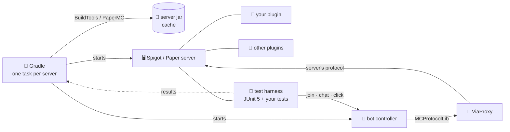

<div align="center">

# 🧪 spigot-testing

**Real-server tests for Spigot & Paper plugins — from 1.8.8 to 26.x — with Gradle and JUnit 5.**

Your plugin, on real servers, against real players, on every Minecraft version you support.

[](https://github.com/lars-lewerenz/spigot-testing/actions/workflows/ci.yml)


[Features](#-features) ·
[Quick start](#-quick-start) ·
[Writing tests](#%EF%B8%8F-writing-tests) ·
[Fake players](#-fake-players) ·
[Other plugins](#-other-plugins) ·
[Configuration](#%EF%B8%8F-configuration) ·
[CI](#-ci-on-github-actions) ·
[How it works](#%EF%B8%8F-how-it-works)

</div>

---

Mocking the Bukkit API only tells you how your plugin behaves against your *idea* of the server.
**spigot-testing** starts the real thing — Spigot built with BuildTools, Paper straight from
PaperMC — loads your plugin, runs your JUnit 5 tests inside it, lets bot players join over the
real network protocol, and does that for every version you list, in parallel.

```text
$ ./gradlew serverTest
[Spigot 1.8.8]   PASSED GreeterMenuTest > clickingThePaperGreetsAndClosesTheMenu()
[Paper 26.3]   PASSED GreeterPlayerTest > chatReachesOtherPlayers()
…
[Spigot 1.8.8] CraftBukkit git-Spigot-3c60ece-741a1bd (MC: 1.8.8): 13 tests, 13 passed, 0 failed, 0 skipped, 0 aborted (14 s)
[Paper 1.8.8] CraftBukkit git-PaperSpigot-445 (MC: 1.8.8): 13 tests, 13 passed, 0 failed, 0 skipped, 0 aborted (15 s)
[Spigot 1.12.2] CraftBukkit git-Spigot-79a30d7-f4830a1 (MC: 1.12.2): 13 tests, 13 passed, 0 failed, 0 skipped, 0 aborted (16 s)
[Spigot 26.3] Spigot 4664-Spigot-bed90fc-e89124d (MC: 26.3): 13 tests, 13 passed, 0 failed, 0 skipped, 0 aborted (21 s)
[Spigot 1.20.4] CraftBukkit 4090-Spigot-b754dcc-38b1f49 (MC: 1.20.4): 13 tests, 13 passed, 0 failed, 0 skipped, 0 aborted (22 s)
[Spigot 1.21.11] CraftBukkit 4598-Spigot-56165ca-d74c5d8 (MC: 1.21.11 Unobfuscated): 13 tests, 13 passed, 0 failed, 0 skipped, 0 aborted (23 s)
[Paper 26.3] Paper 26.3-253-63e41db (MC: 26.3): 13 tests, 13 passed, 0 failed, 0 skipped, 0 aborted (23 s)
[Paper 1.21.11] Paper 1.21.11-132-c5eb079 (MC: 1.21.11): 13 tests, 13 passed, 0 failed, 0 skipped, 0 aborted (26 s)

BUILD SUCCESSFUL in 30s
```

## ✨ Features

|   |   |
|---|---|
| 🖥️ **Real servers** | Spigot built with BuildTools, Paper downloaded from PaperMC. One Gradle task per server, all running in parallel. |
| 🕰️ **1.8.8 → 26.x** | Every version runs on the Java it needs (8, 17, 21, 25) — picked from the server's metadata and downloaded by Gradle toolchains. |
| 🤖 **Fake players** | Bots join over the real network protocol, chat, run commands and receive messages — on every version, through ViaProxy. |
| 🗃️ **Inventory GUIs** | Bots see the menus your plugin opens and click them; you get genuine `InventoryClickEvent`s. |
| 🔌 **Other plugins** | Vault, PlaceholderAPI, LuckPerms… installed next to yours from Maven, local files or download URLs. |
| 🎯 **Just JUnit 5** | Familiar assertions and annotations; JUnit XML reports for your CI. |
| 🧩 **Unit tests too** | Plain `src/test` tests on the build JVM, with the Spigot API on the classpath. |
| ⚡ **Fast after the first run** | Servers, JDKs and downloads are cached per machine: 8 servers × 13 tests in ~30 s. |

### Supported servers

Everything below runs in this repo's CI on every push — the example plugin's full test suite on 8 servers.

| Server | Versions tested here | Java | Where the jar comes from |
|---|---|---|---|
| **Spigot** | 1.8.8 · 1.12.2 · 1.20.4 · 1.21.11 · 26.3 | 8 · 8 · 17 · 21 · 25 | built with [BuildTools](https://www.spigotmc.org/wiki/buildtools/), cached |
| **Paper** | 1.8.8 · 1.21.11 · 26.3 | 8 · 21 · 25 | downloaded from [PaperMC](https://papermc.io/downloads), cached |

Other versions in between work the same way — list them and go.

## 🚀 Quick start

**1.** Apply the plugin and pick your servers:

```kotlin
// build.gradle.kts
plugins {
    java
    id("io.github.lars-lewerenz.spigot-testing")
}

dependencies {
    compileOnly("org.spigotmc:spigot-api:1.8.8-R0.1-SNAPSHOT") // the oldest API you support
}

tasks.withType<JavaCompile>().configureEach {
    options.release = 8 // the oldest Java you support
}

spigotTesting {
    versions = listOf("1.8.8", "1.21.11", "26.3")  // Spigot
    paperVersions = listOf("1.21.11", "26.3")      // Paper
}
```

**2.** Write a test in `src/serverTest/java`:

```java
class MyPluginTest {

    @Test
    void helloCommandAnswers() {
        CommandResult result = ServerTest.dispatchCommand("hello Steve");

        assertEquals(singletonList("Hello, Steve!"), result.messages());
    }
}
```

**3.** Run it:

```bash
./gradlew serverTest -PspigotTesting.acceptEula=true
```

> [!IMPORTANT]
> Running a Minecraft server means accepting the [Minecraft EULA](https://aka.ms/MinecraftEULA).
> The server tests won't start until you do so by setting the Gradle property
> `spigotTesting.acceptEula=true` — on the command line as above, or once in
> `~/.gradle/gradle.properties`.

> [!NOTE]
> The first run builds Spigot with BuildTools (2–3 minutes per version, in parallel) and
> downloads the JDKs. Everything is cached in `~/.gradle`, so later runs start the servers right away.

| Command | Runs |
|---|---|
| `./gradlew test` | unit tests (`src/test`) on the build JVM — seconds |
| `./gradlew serverTest` | server tests (`src/serverTest`) on every configured server |
| `./gradlew serverTest_1_21_11` | … on Spigot 1.21.11 only |
| `./gradlew serverTest_paper_26_3` | … on Paper 26.3 only |
| `./gradlew check` | all of it |

Add `--continue` to see every server's results even when one of them fails.

## ✍️ Writing tests

| | 🧩 Unit tests | 🖥️ Server tests |
|---|---|---|
| **Sources** | `src/test/java` | `src/serverTest/java` |
| **Runs on** | the build JVM | a real server, once per configured version |
| **Bukkit API** | on the classpath, no server (`Bukkit.getServer()` is `null`) | fully working |
| **Good for** | logic you can keep free of the running server | commands, events, scheduler, worlds, entities, players |

Server tests are plain JUnit 5 classes. A few things to know:

- 🧵 **Threads:** test methods (and `@BeforeEach` etc.) run **on the server main thread**, so you
  can call the Bukkit API directly. Annotate a test (or class) with **`@OffMainThread`** when it
  has to wait for the server — then use `ServerTest.sync(...)` for Bukkit calls.
- 🔒 **Class loaders:** your tests are loaded by a different class loader than your plugin, so they
  see only your plugin's **public** API, even from the same package.
- ☕ **Java version:** compile the tests for the oldest Java you target (`options.release = 8` for
  1.8.8 – 1.16.5).

### Helpers

| `ServerTest.…` | |
|---|---|
| `dispatchCommand("cmd args")` | runs a command as the console and records the replies → `CommandResult` |
| `sync(() -> …)` | runs code on the main thread and returns its result (for `@OffMainThread` tests) |
| `awaitTicks(n)` | lets the server tick `n` times (for `@OffMainThread` tests) |
| `recordEvents(SomeEvent.class)` | records events after every plugin has handled them → `EventRecorder` |

<details>
<summary><b>Example: commands, events and the scheduler</b></summary>

```java
class GreeterServerTest {

    private final GreeterPlugin plugin = JavaPlugin.getPlugin(GreeterPlugin.class);

    @Test
    void greetCommandGreetsByName() {
        CommandResult result = dispatchCommand("greet Steve");

        assertTrue(result.success());
        assertEquals(singletonList(ChatColor.GREEN + "Hello, Steve!"), result.messages());
    }

    @Test
    void creeperSpawnsAreCancelled() {
        EventRecorder<CreatureSpawnEvent> spawns = recordEvents(CreatureSpawnEvent.class);
        World world = Bukkit.getWorlds().get(0);

        world.spawnEntity(world.getSpawnLocation(), EntityType.CREEPER);

        assertTrue(spawns.events().get(0).isCancelled());
    }

    @Test
    @OffMainThread // waits for the server, so it must not block the main thread
    void nightIsSkipped() {
        World world = sync(() -> Bukkit.getWorlds().get(0));
        sync(() -> world.setTime(18000)); // midnight

        awaitTicks(40); // the plugin checks once a second

        assertTrue(sync(world::getTime) < 12000);
    }
}
```

</details>

## 🤖 Fake players

`Bots.join(name)` connects a **bot client over the real network protocol**. The server runs its
normal login, so your plugin sees a real player: `PlayerLoginEvent`, `PlayerJoinEvent`,
permissions, commands, chat, quitting — all of it.

```java
@OffMainThread // bots wait for the server, so it has to keep ticking
class GreeterPlayerTest {

    @Test
    void joiningPlayersAreWelcomed() {
        Bot alex = Bots.join("Alex");

        assertEquals(ChatColor.YELLOW + "Welcome, Alex!", alex.awaitMessage("Welcome"));
    }

    @Test
    void chatReachesOtherPlayers() {
        Bot alex = Bots.join("Alex");
        Bot bob = Bots.join("Bob");

        alex.chat("hi bob");

        assertTrue(bob.awaitMessage("hi bob").contains("Alex"));
    }
}
```

### 🗃️ Inventory GUIs

Bots see the inventories your plugin opens for them and click them with real click packets:

```java
@Test
void clickingThePaperGreetsAndClosesTheMenu() {
    Bot alex = Bots.join("Alex");
    alex.chat("/menu");
    alex.awaitInventory("Greeter Menu");

    alex.click(GreeterMenu.GREET_SLOT);                    // or click(slot, ClickType.SHIFT_LEFT)

    assertEquals(ChatColor.GREEN + "Hello, Alex!", alex.awaitMessage("Hello"));
}
```

| `Bot.…` | |
|---|---|
| `player()` | the server-side Bukkit `Player` (use it inside `ServerTest.sync(...)`) |
| `chat(text)` | sends chat — or a command, if it starts with `/` |
| `messages()` · `awaitMessage(text)` | what the client received, with `§` color codes |
| `awaitInventory(title)` · `openInventoryTitle()` | the inventory open on the client |
| `click(slot)` · `click(slot, ClickType)` | `LEFT`, `RIGHT`, `SHIFT_LEFT`, `SHIFT_RIGHT` on a raw slot number, like `InventoryClickEvent#getRawSlot` |
| `closeInventory()` | closes it, like pressing Escape |
| `quit()` · `isOnline()` | disconnects and waits until the server has removed the player |

> [!TIP]
> Bots still online at the end of a test are disconnected automatically, and event recorders
> stop — every test starts from a clean slate.

<details>
<summary><b>How bots reach every version</b></summary>

The bots use [MCProtocolLib](https://github.com/GeyserMC/MCProtocolLib), which speaks the newest
protocol, and connect through [ViaProxy](https://github.com/ViaVersion/ViaProxy), which translates
it to whatever the server speaks — so one client works from 1.8.8 to 26.x. Both run in a separate
process next to the server on Java 21 (provisioned like the other JDKs). The bot client ships
inside the Gradle plugin; ViaProxy is downloaded once into the cache and only started when a test
actually uses bots.

</details>

## 🔌 Other plugins

Install the plugins yours works with next to it — and use their APIs in your tests:

```kotlin
dependencies {
    compileOnly("me.clip:placeholderapi:2.12.3")              // API to compile against
    serverTestPlugin(files("libs/SomePlugin.jar"))             // a local plugin jar
    serverTestPlugin("com.example:some-plugin:1.0")            // a runnable plugin jar from Maven
}

spigotTesting {
    pluginUrls.addAll(                                         // plugins that are only downloads
        "https://github.com/PlaceholderAPI/PlaceholderAPI/releases/download/2.12.3/PlaceholderAPI-2.12.3.jar",
        "https://github.com/MilkBowl/Vault/releases/download/1.7.3/Vault.jar",
    )
}
```

```java
String count = sync(() -> PlaceholderAPI.setPlaceholders(alex.player(), "%greeter_greetings%"));
```

- The test harness soft-depends on all of them, so they're enabled before your tests run.
- `serverTestPlugin` jars are also on the server tests' compile classpath; downloads are cached.

> [!WARNING]
> Many plugins publish only their **API** on Maven — PlaceholderAPI's Maven jar lacks the
> libraries the real plugin bundles and won't load. Compile against the API; install the real
> plugin from its release download.

## ⚙️ Configuration

```kotlin
spigotTesting {
    versions = listOf("1.8.8", "1.21.11")              // Spigot versions
    paperVersions = listOf("26.3")                     // Paper versions
    pluginUrls.add("https://…/OtherPlugin.jar")        // other plugins for the test servers
    pluginJar = tasks.shadowJar.flatMap { it.archiveFile } // default: the jar task's output
    jvmArgs = listOf("-Xmx2G")                         // default
    timeout = java.time.Duration.ofMinutes(10)         // per server run (default)
    acceptEula = true                                  // default: Gradle property spigotTesting.acceptEula
    cacheDirectory = layout.projectDirectory.dir(".spigot") // default: ~/.gradle/caches/spigot-testing
}
```

Gradle needs to be able to download the JDKs the servers need — add the toolchain resolver to
`settings.gradle.kts`:

```kotlin
plugins {
    id("org.gradle.toolchains.foojay-resolver-convention") version "1.0.0"
}
```

## 🔁 CI on GitHub Actions

This repo's [workflow](.github/workflows/ci.yml) is a complete example: one job per server in a
matrix, Spigot jars cached between runs, server logs and JUnit reports uploaded on failure.
With warm caches a full run of all 8 servers takes about **3 minutes**.

```yaml
- uses: actions/cache@v6
  with:
    path: ~/.gradle/caches/spigot-testing/servers
    key: spigot-servers-v1
- run: ./gradlew serverTest -PspigotTesting.acceptEula=true
```

> [!NOTE]
> In this repo the server tests only run once the repository variable `ACCEPT_MINECRAFT_EULA` is
> `true`, so accepting the EULA in CI stays an explicit choice of the repo owner.

## 🛠️ How it works



For each server, `serverTest_<version>`:

1. **Gets the server.** Spigot is built with BuildTools (Spigot jars can't be redistributed);
   Paper's latest build is downloaded from PaperMC and checked against its SHA-256. The Java
   version comes from the server's own metadata. Jars are cached in
   `~/.gradle/caches/spigot-testing/servers`.
2. **Packages a harness plugin:** your `src/serverTest` classes, the test runtime and JUnit, with a
   generated `plugin.yml` that depends on your plugin and soft-depends on the other plugins.
3. **Starts the server** in `build/spigot-testing/<server>/server` — flat world, offline mode,
   random port on 127.0.0.1 — with your plugin, the other plugins and the harness, plus the bot
   controller next to it.
4. **Runs the tests** on the first tick with the JUnit Platform launcher, then stops the server.
   Results stream into the build output; JUnit XML reports and the server log land in
   `build/spigot-testing/<server>/results`.

## 📁 Repository layout

```text
framework/                 the framework (an included Gradle build)
├── gradle-plugin/         Gradle plugin io.github.lars-lewerenz.spigot-testing (Java 17+)
├── runtime/               runs inside the server: ServerTest, Bots, EventRecorder, JUnit runner (Java 8)
└── bots/                  bot controller: MCProtocolLib + ViaProxy (Java 21), bundled into the plugin
example-plugin/            "Greeter": /greet, a /menu GUI, welcome messages, creeper blocking,
                           night skipping, a PlaceholderAPI placeholder — and tests for all of it
```

## 📦 Using it in another project

Until it's published, install it into your local Maven repository:

```bash
./gradlew -p framework publishToMavenLocal
```

```kotlin
// settings.gradle.kts
pluginManagement {
    repositories { mavenLocal(); gradlePluginPortal() }
}

// build.gradle.kts
plugins { id("io.github.lars-lewerenz.spigot-testing") version "0.1.0-SNAPSHOT" }
repositories {
    mavenLocal()
    mavenCentral()
    maven("https://hub.spigotmc.org/nexus/content/groups/public/")
}
```

## 🧭 Limitations & ideas

- **Bots** join, chat, run commands, click inventory GUIs and quit. They don't yet move or
  interact with blocks and entities from the client side — do that through `bot.player()`.
- **Offline mode:** bots join with unsigned chat on servers running `online-mode=false`.
- **Same plugins everywhere:** other plugins are installed on every server, so pick versions that
  cover your whole range.
- **Ideas:** client-side movement and block interaction, what the client sees beyond chat (titles,
  scoreboards, boss bars), restarting the server within a test run to check persistence.
